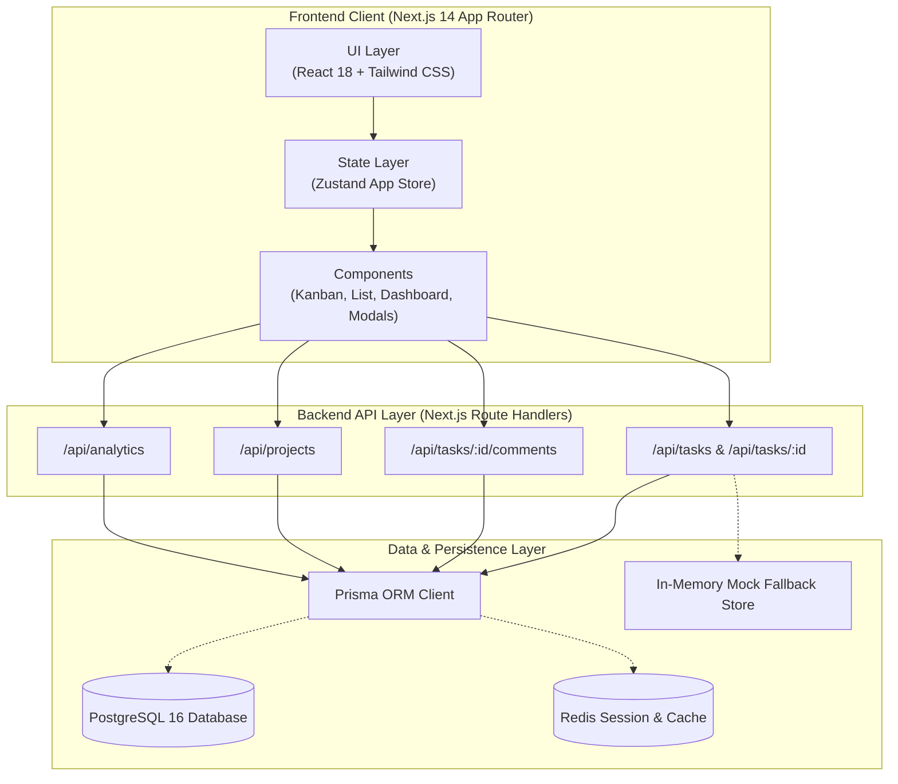
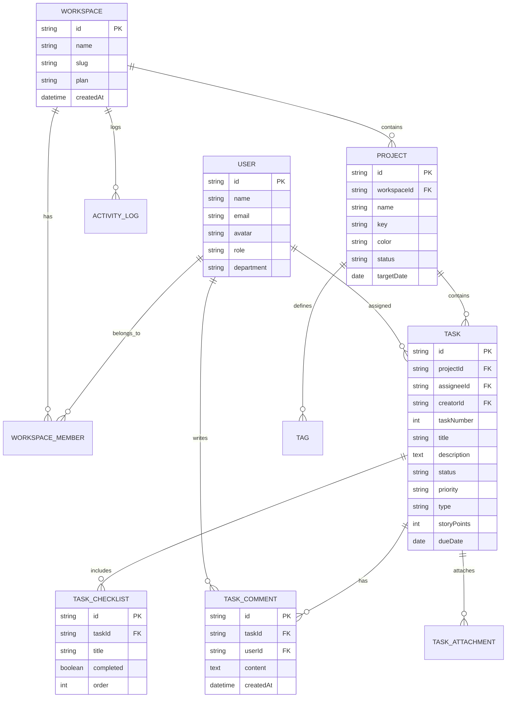

# FlowCraft — Enterprise SaaS Task & Project Management

[](https://nextjs.org/)
[](https://www.typescriptlang.org/)
[](https://tailwindcss.com/)
[](https://www.prisma.io/)
[](https://www.postgresql.org/)
[](LICENSE)

FlowCraft is a high-performance, full-stack enterprise project and task management platform inspired by Linear, Jira, and Asana. Engineered with Next.js 14 App Router, React 18, TypeScript, Tailwind CSS, Prisma ORM, and Zustand client store.

---

## 🌟 Key Features

- **Interactive Kanban Board**: Dynamic status columns (`Backlog`, `To Do`, `In Progress`, `In Review`, `Done`), drag-and-drop status transitions, priority badges, checklist counters, and overdue warning badges.
- **Structured Task List View**: Grouped task tables with inline priority changers, inline status dropdowns, assignee tags, and due date alerts.
- **Executive Analytics Dashboard**: Real-time KPI metric cards (Total issues, Completion rate %, Active in-flight items, Overdue tickets), visual status distribution meter, priority breakdown, and recent team activity audit log.
- **Project Portfolios**: Multi-project tracking with progress bars, issue count metrics, target delivery dates, and assigned team members.
- **Team & Workspace Management**: Role-based access control (`OWNER`, `ADMIN`, `MEMBER`, `GUEST`), department allocation, and member invitation modal.
- **Slide-Over Task Drawer**: Detailed task inspector with live title editing, status & priority toggles, assignee selector, due date picker, interactive checklist with progress bar, and threaded activity comments.
- **Zero-Config Standalone Operation**: Out-of-the-box preloaded demo state with realistic team members, projects, and 18+ tasks, with seamless PostgreSQL fallback.
- **Dark & Light Mode**: Seamless theme toggle powered by Tailwind CSS tokens.
- **Keyboard Shortcuts**: Power user workflow shortcuts (`?` for help, `c` for quick task creation, `Esc` to close).

---

## 📐 System Architecture



---

## 🗄️ Database Entity Relationship (ERD)



---

## 🚀 Quick Start Guide

### Prerequisites
- **Node.js** >= 18.17 (Node 20+ recommended)
- **npm** or **pnpm** or **yarn**
- **Docker & Docker Compose** (Optional, for running PostgreSQL locally)

### Option 1: Standalone Development Mode (Zero Database Config)
The application includes a rich in-memory seed dataset allowing you to test all features immediately without configuring a database.

```bash
# 1. Clone the repository
git clone https://github.com/nabilpwqz/saas-task-manager.git
cd saas-task-manager

# 2. Install dependencies
npm install

# 3. Start development server
npm run dev
```

Open [http://localhost:3000](http://localhost:3000) in your browser.

---

### Option 2: Running with PostgreSQL via Docker Compose

```bash
# 1. Start PostgreSQL 16 and Redis containers
docker compose up -d

# 2. Configure environment file
cp .env.example .env

# 3. Push schema to database and generate client
npx prisma db push
npx prisma generate

# 4. Populate database with initial mock seed
npm run prisma:seed

# 5. Launch the application
npm run dev
```

---

## 📁 Project Directory Structure

```text
├── app/
│   ├── api/
│   │   ├── analytics/route.ts      # Workspace metrics calculation
│   │   ├── projects/route.ts       # Projects listing & creation
│   │   └── tasks/
│   │       ├── route.ts            # Tasks CRUD & query filter handler
│   │       └── [id]/
│   │           ├── route.ts        # Task detail, patch, & delete
│   │           └── comments/route.ts
│   ├── globals.css                 # Tailwind CSS directives & root variables
│   ├── layout.tsx                  # Root layout & HTML shell
│   └── page.tsx                    # Active view router & modal container
├── components/
│   ├── board/                      # Kanban board & task card components
│   ├── dashboard/                  # Analytics KPI cards & SVG charts
│   ├── filters/                    # Filter toolbar with search & multi-select
│   ├── layout/                     # Sidebar, header, & responsive shell
│   ├── list/                       # Grouped table & list views
│   ├── projects/                   # Projects grid & creation modal
│   ├── team/                       # Workspace member roster & invite modal
│   ├── tasks/                      # Slide-over detail drawer & task creation
│   └── ui/                         # Atomic design system (Button, Badge, Avatar, Modal, Card)
├── lib/
│   ├── constants.ts                # Board columns, priority & status definitions
│   ├── mock-data.ts                # Pre-populated domain models & tasks
│   ├── prisma.ts                   # Prisma client singleton
│   ├── store.ts                    # Zustand reactive state store
│   └── utils.ts                    # ClassNames merger, date & overdue helpers
├── prisma/
│   ├── schema.prisma               # Enterprise PostgreSQL relational schema
│   └── seed.ts                     # Database seeder script
├── tests/
│   └── task-utils.test.ts          # Unit test suite
├── docker-compose.yml              # Local PostgreSQL 16 & Redis stack
├── vitest.config.ts                # Vitest test runner configuration
└── tailwind.config.ts              # Custom design tokens & dark mode styling
```

---

## 🔌 RESTful API Reference

| Method | Endpoint | Description | Query Parameters |
| :--- | :--- | :--- | :--- |
| `GET` | `/api/tasks` | Retrieve tasks list | `status`, `priority`, `assigneeId`, `projectId`, `q` |
| `POST` | `/api/tasks` | Create new issue | - |
| `GET` | `/api/tasks/:id` | Fetch task details | - |
| `PATCH` | `/api/tasks/:id` | Update task attributes | - |
| `DELETE` | `/api/tasks/:id` | Remove task | - |
| `GET` | `/api/tasks/:id/comments` | Fetch task comments | - |
| `POST` | `/api/tasks/:id/comments` | Add new task comment | - |
| `GET` | `/api/projects` | List all projects | - |
| `POST` | `/api/projects` | Create new project | - |
| `GET` | `/api/analytics` | Summary metrics | - |

---

## ⌨️ Productivity Keyboard Shortcuts

| Shortcut | Description |
| :--- | :--- |
| <kbd>c</kbd> | Open **Create Task** dialog from anywhere |
| <kbd>?</kbd> | Display **Keyboard Shortcuts** reference guide |
| <kbd>Esc</kbd> | Dismiss active slide-over drawer or modal |
| <kbd>Ctrl</kbd> + <kbd>Enter</kbd> | Submit comment or quick-save changes |

---

## 🧪 Testing & Verification

Run the automated test suite with Vitest:

```bash
# Run unit tests
npm test

# Run tests in watch mode
npm run test:watch
```

---

## 📄 License

This project is licensed under the MIT License - see the [LICENSE](LICENSE) file for details.
